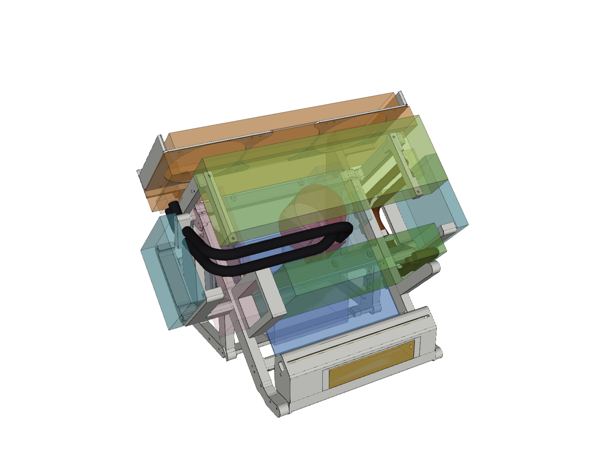

# Ossa

Ossa is an open, 3D-printed PC case for a liquid-cooled build, modelled as CadQuery scripts. A rigid plate skeleton holds every component. An organic outer layer of bones and thread-like films is decoration fixed to that skeleton and carries nothing.

This is a design study. Some fit gauges have been printed and tried; no case part has been printed yet.

| Skeleton with hardware | Organic layer |
|---|---|
|  |  |

## Layout

The current layout is called B6.

- The motherboard leans back at 45°.
- The graphics card's 360 mm radiator lies parallel to the board, above it.
- The CPU's 420 mm radiator stands at 90° to the board, behind its top edge.
- Neither pump is the highest point of its loop. That was the reason for the layout.
- Radiator fans sit on the outside and blow in. Two 140 mm fans stand on the flanks, outside the radiators' ends since revision 13 (|X| 235..260), and exhaust.
- The power supply sits under the board. The front I/O module sits in its carrier on the front beam.
- Both hose pairs run inside the envelope, so nothing sticks out to snag.

The case is 520.0 mm wide, 382.0 mm deep and 400.0 mm high. The depth is the skeleton's; the organic layer stands up to 24 mm in front of it. The skeleton itself stays inside |X| 229; the side-fan brackets reach the fans' inner face at |X| 235. Every part of the skeleton is 290 mm or shorter, to fit a 300 mm printer bed; the organic layer's piece `main` is not yet split into pieces that fit.

The skeleton is 36 printed parts: 2809.7 cm³, 2925.0 g solid, 1557.6 g at 4 walls and 20 % infill, of which the ABS is 1534.6 g. The organic layer is two pieces, counted in its own report: `main` 2015.5 cm³ (2560 g of PETG solid) and `rear_panel` 305.5 cm³ (388 g); the budget records 2321.1 cm³ for the two together (the report rounds each piece to 0.1 cm³). Revision 14a made the card's right-hand rest (`gpu_rest`) and the front I/O module's carrier (`front_io_carrier`) separate small parts, and put the CPU hose clip on the left fan's free corner. Revision 16 cut an open groove through the knee of `visor_arm_left` and `visor_arm_right` so the 360's screw at that end can pass its head. Revision 17 adds the layer's second piece, the rear panel, on four pads, 321 mm wide, printed upright and turned 45 degrees, and taken off before a drive comes out. Revision 18 removes the front sill and the light line, and holds the carrier by four M3 x 25 from below through `beam_front`. Revision 19 sets the bone over the card, `card`, 2.6 mm in front of the plane of the card's fans, runs the front film from the bone over the I/O module's carrier up to that bone, and keeps a window in the films over the card's power connector (X -25.5 to 47).

| Component | Model |
|---|---|
| Motherboard | MSI MAG Z890 Tomahawk WiFi (ATX) |
| Graphics card | MSI RTX 5080 SUPRIM LIQUID, 360 mm radiator |
| CPU cooler | ARCTIC Liquid Freezer III Pro 420 |
| Power supply | Seasonic PRIME TX-1600 Noctua Edition |
| Front I/O | Module from a Fractal North XL (not yet measured, placeholder in the model) |

## Repository map

| Path | What it is |
|---|---|
| `cad_b6/hardware.py` | The only place hardware dimensions and mounting coordinates live |
| `cad_b6/frame_v0.py` | The skeleton, its checks, the report and the STEP export |
| `cad_b6/rounding.py` | Rounds the skeleton's corners where the checks allow it |
| `cad_b6/test_checks.py` | Damages the model on purpose to prove each check fails when it should (328 cases) |
| `cad_b6/assembly_access.py`, `cad_b6/test_assembly.py` | Whether every screw can be driven, and one order of assembly: the 360 with its two arms is a bench group, and a part that only sits on another goes on after it (52 cases) |
| `cad_b6/skeleton_screws.py` | The skeleton's screws (seat, axis, head, washer) that both `assembly_access.py` and the organic layer read |
| `cad_b6/hoses.py`, `hose_routes.py` | Hose routes built from straight runs and constant-radius bends |
| `cad_b6/strength.py` | Linear finite-element check of the skeleton, and plastic needed per infill |
| `cad_b6/organic_frame.py`, `organic_strength.py`, `organic_manifest.py` | The organic outer layer as named pieces with their fixings, the strength check of each piece, and a fingerprint of each piece |
| `cad_b6/cables.py` | Eleven cable routes and their checks |
| `cad_b6/fit_gauges.py` | Thin test plates that check the model's numbers against the real hardware |
| `cad_b6/render_vtk.py`, `render_full.py`, `measure.py` | Offscreen renders (`render_full.py` draws the whole design from every side) and distance measurements |
| `docs/plans/b6-frame-v0.md` | The design record: every revision, with reasons and coordinates |
| `docs/printer-and-materials.md` | Printer and filament the design is made for |
| `cad_b5/`, `history/` | The earlier B5 layout and studies. Frozen. |
| `refs/SOURCES.txt` | Where the reference images came from. The images are not in the repository. |

## Run it

The scripts need Python 3.13.

```bash
python3 -m venv .venv
.venv/bin/pip install -r requirements.txt

.venv/bin/python cad_b6/frame_v0.py      # build, run every check, write the report and STEP
.venv/bin/python cad_b6/test_checks.py   # 328 cases, worker processes, about 6 minutes; the record is out/test_checks/fast.json; prove the checks bite
.venv/bin/python cad_b6/test_checks.py --serial  # the same suite in one process; the record is out/test_checks/serial.json
.venv/bin/python cad_b6/test_checks.py --diff out/test_checks/serial.json out/test_checks/fast.json  # compare two runs: the case lists must be identical
.venv/bin/python cad_b6/test_runner.py   # the runner on a fake suite: a dropped or emptied section, a short --diff, a file that moves during the run, and, in worker processes, a section that raises or a worker that dies, all fail
.venv/bin/python cad_b6/test_budgets.py  # each budget fails when exceeded, when its input is missing, when a figure falls under its floor, and when the suite's record is of other code, other packages or another Python
.venv/bin/python cad_b6/check_budgets.py # one line per budget of the skeleton's ABS, the organic layer, the suite's counts and the strength run's load cases; exit 1 on a FAIL
.venv/bin/python cad_b6/organic_trial.py # the boxed trial of the organic layer is one closed piece with its pad inside; writes out/organic/trial_base_mid_R.stl
.venv/bin/python cad_b6/test_properties.py  # property tests of the helper functions; ends PASS (a known failure is listed, not hidden)
.venv/bin/python cad_b6/test_organic.py  # 74 cases, 52 with --quick: the organic layer's checks fail when the field is damaged
.venv/bin/python cad_b6/zone_access.py   # plug zones free; bundles 52 mm and 72 mm, and 52 mm and 56 mm with the layer; a hand, 50 mm without the layer and 44 mm with it
.venv/bin/python cad_b6/assembly_access.py  # about 3 minutes: every screw against the assumed tools; the 360 with its two arms is a bench group, and a node in SITS_ON goes on after what it sits on; writes the order to out/assembly/order.md; exit 0 when that order drives every screw, exit 1 when a screw cannot be driven, no order exists, the order fails the same check, or a bench group or SITS_ON names a node that is not one (tests: cad_b6/test_assembly.py, 52 cases)
.venv/bin/python cad_b6/parts_manifest.py --expect <parts>  # exit 1 names any part or hardware solid that changed outside the list
.venv/bin/python cad_b6/organic_manifest.py --expect <pieces>  # exit 1 names any piece of the organic layer that changed outside the list
.venv/bin/python cad_b6/render_vtk.py    # previews/b6_v0_*.png
.venv/bin/python cad_b6/render_full.py   # previews/b6_full_*.png, the whole design
.venv/bin/python cad_b6/render_blender.py # meshes for the Blender render (cad_b6/blender_scene.py, previews/b6_render_*.png)
.venv/bin/python cad_b6/organic_strength.py  # about 18 minutes on the Mac (1100 s on 20 Nov 2026, 1075 s of it the piece `main`; 1950 s before its load cases were solved 64 at a time): judges each piece, a 30 N push and a probe on each film strand and cross-thread; run once per revision, not after every edit; exits with an error if a push is over the allowable stress or the piece moves more than 5 mm
.venv/bin/python cad_b6/strength.py 7 2  # strength and plastic, about 3.5 minutes on Apple silicon (Accelerate through the macldlt package)
```

`cad_b6/parts_manifest.py --write` rewrites `cad_b6/parts_manifest.json`. Use it only in the commit that carries the revision, after its table has been read.

Run them from the repository root.

## What the checks cover

`frame_v0.py` stops with an error if any of these fails:

1. No two components overlap.
2. No printed part overlaps a component.
3. No two printed parts overlap.
4. Every part of the skeleton is 290 mm or shorter.
5. Every component has its holders and its full count of fasteners.
6. Nothing reaches below the desk plane.
7. Every hole is empty and has enough wall around it.
8. Everything stays inside the envelope.
9. Every part keeps 5 mm from the hoses.
10. The hose guides hold the real hose path.
11. The side fans keep a clear opening.
12. Every corner left sharp has a stated reason.

The owner's inserts are 4.0 mm long and 4.96 mm in outer diameter, the pilot is 4.5 mm wide and 6.7 mm deep, and each insert is set flush with the face (`docs/printer-and-materials.md`).

A separate check keeps each contact face at 97 % of its area or more after rounding.

## Strength

`strength.py` meshes the bonded skeleton and loads it with each component's weight. Infill is modelled as a solid wall plus a weaker core. It does not cover creep near warm radiators, strength across layers, insert pull-out or slip in bolted joints. The numbers are in `cad_b6/report_strength.txt`.

## Materials

- **Skeleton:** ABS. It carries every component.
- **Organic layer:** PETG, with ABS as the fallback (it was PLA until 16 Nov 2026). It keeps the 10 mm from the graphics card and the power supply it was drawn with.
- **Hose guides:** PA6 nylon (their mouths snap over the hose). The cable tie bridges are ABS: a hook-and-loop strap holds the cable, nothing snaps.

## Not done yet

- The rear panel's upright print is not tried.
- `main` is still not split into printable pieces.
- The layer in PETG: the owner printed the trial piece (`cad_b6/organic_trial.py`, `out/organic/trial_base_mid_R.stl`) on 18 Nov 2026 and found no problem with the surface's steps, the supports or the strength (`docs/printer-and-materials.md`). The piece `main` still has to be split into pieces that fit the bed.
- The front I/O module's real dimensions.
- The pilot's diameter of 4.5 mm comes from the ladder C2 printed in PETG (the owner, 18 Nov 2026: the inserts sit best in 4.5 to 4.6 mm; before that it was the maker's 4.4). The skeleton is ABS: the figure is confirmed on the first small ABS part.
- The second pass of the fit gauges with the PC apart (G1, G2, G3, G4a, G4b) and the coupons C1 and C2.
- The Blender pictures (stale since revision 13).
- Eleven cable routes are drawn and checked, and eleven tie points for hook-and-loop straps shape them. The graphics card's power cable is 550 mm of 700, with a 2 mm straight and a 12 mm bend right behind the plug in its last section (the owner's cable; the rest of the route keeps a bend of 35). The arch's top is at n 164 and the cable stands 25.4 mm behind the front plane. The owner's permission of up to 11 mm in front of that plane stays and is not needed.
- The tools `assembly_access.py` uses are assumptions until the owner names his.

## Working with coding agents

`CLAUDE.md` and `AGENTS.md` hold the working rules for agent sessions. `.claude/` holds a verification skill and a CAD subagent.

## Licence

Ossa © 2026 Deikus-LXXVII. Licensed under [CC BY-NC-SA 4.0](LICENSE) (Creative Commons Attribution-NonCommercial-ShareAlike 4.0 International).

- You may print it for yourself, study it, change it and share your version.
- You may not use it commercially. That includes selling the files or printed cases.
- Give credit, and share changed versions under the same licence.

The licence text is the authority; this list is only a summary.
