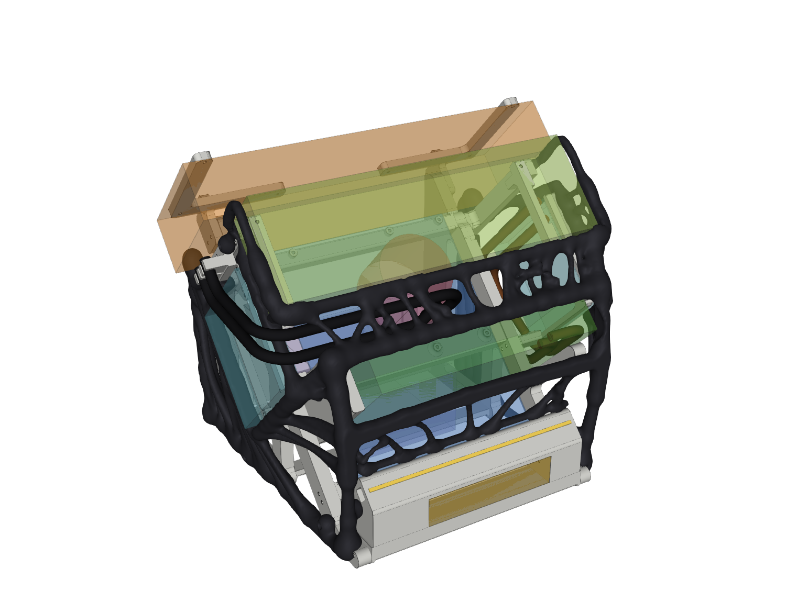

# Ossa

Ossa is an open, 3D-printed PC case for a liquid-cooled build, modelled as CadQuery scripts. A rigid plate skeleton holds every component. An organic outer layer of bones and thread-like films is decoration fixed to that skeleton and carries nothing.

This is a design study. Nothing has been printed yet.

| Skeleton with hardware | Organic layer (sketch) |
|---|---|
|  |  |

## Layout

The current layout is called B6.

- The motherboard leans back at 45°.
- The graphics card's 360 mm radiator lies parallel to the board, above it.
- The CPU's 420 mm radiator stands at 90° to the board, behind its top edge.
- Neither pump is the highest point of its loop. That was the reason for the layout.
- Radiator fans sit on the outside and blow in. Two 140 mm fans on the flanks exhaust.
- The power supply sits under the board. A sill at the front holds the I/O module and a light line.
- Both hose pairs run inside the envelope, so nothing sticks out to snag.

The envelope is about 460 × 385 × 405 mm (width × depth × height). Every printed part is 290 mm or shorter, to fit a 300 mm printer bed.

| Component | Model |
|---|---|
| Motherboard | MSI MAG Z890 Tomahawk WiFi (ATX) |
| Graphics card | MSI RTX 5080 SUPRIM LIQUID, 360 mm radiator |
| CPU cooler | ARCTIC Liquid Freezer III Pro 420 |
| Power supply | Seasonic PRIME TX-1600 Noctua Edition |
| Front I/O | Module from a Fractal North XL (not yet measured, placeholder in the model) |

## Repository map

| Path | What it is |
|---|---|
| `cad_b6/hardware.py` | The only place hardware dimensions and mounting coordinates live |
| `cad_b6/frame_v0.py` | The skeleton, its checks, the report and the STEP export |
| `cad_b6/rounding.py` | Rounds the skeleton's corners where the checks allow it |
| `cad_b6/test_checks.py` | Damages the model on purpose to prove each check fails when it should |
| `cad_b6/hoses.py`, `hose_routes.py` | Hose routes built from straight runs and constant-radius bends |
| `cad_b6/strength.py` | Linear finite-element check of the skeleton, and plastic needed per infill |
| `cad_b6/organic_frame.py`, `organic_strength.py` | The organic outer layer as one solid with its fixings, and its strength check |
| `cad_b6/cables.py` | Cable routes and their checks |
| `cad_b6/fit_gauges.py` | Thin test plates that check the model's numbers against the real hardware |
| `cad_b6/render_vtk.py`, `render_full.py`, `measure.py` | Offscreen renders (`render_full.py` draws the whole design from every side) and distance measurements |
| `docs/plans/b6-frame-v0.md` | The design record: every revision, with reasons and coordinates |
| `docs/printer-and-materials.md` | Printer and filament the design is made for |
| `cad_b5/`, `history/` | The earlier B5 layout and studies. Frozen. |
| `refs/SOURCES.txt` | Where the reference images came from. The images are not in the repository. |

## Run it

The scripts need Python 3.13.

```bash
python3 -m venv .venv
.venv/bin/pip install -r requirements.txt

.venv/bin/python cad_b6/frame_v0.py      # build, run every check, write the report and STEP
.venv/bin/python cad_b6/test_checks.py   # prove the checks bite
.venv/bin/python cad_b6/render_vtk.py    # previews/b6_v0_*.png
.venv/bin/python cad_b6/render_full.py   # previews/b6_full_*.png, the whole design
.venv/bin/python cad_b6/strength.py 7 2  # strength and plastic, about 7 minutes
```

Run them from the repository root.

## What the checks cover

`frame_v0.py` stops with an error if any of these fails:

1. No two components overlap.
2. No printed part overlaps a component.
3. No two printed parts overlap.
4. Every part is 290 mm or shorter.
5. Every component has its holders and its full count of fasteners.
6. Nothing reaches below the desk plane.
7. Every hole is empty and has enough wall around it.
8. Everything stays inside the envelope.
9. Every part keeps 5 mm from the hoses.
10. The hose guides hold the real hose path.
11. The side fans keep a clear opening.
12. Every corner left sharp has a stated reason.

A separate check keeps each contact face at 97 % of its area or more after rounding.

## Strength

`strength.py` meshes the bonded skeleton and loads it with each component's weight. Infill is modelled as a solid wall plus a weaker core. It does not cover creep near warm radiators, strength across layers, insert pull-out or slip in bolted joints. The numbers are in `cad_b6/report_strength.txt`.

## Materials

- **Skeleton:** ABS. It carries every component.
- **Organic layer:** ABS (it was PLA until 16 Nov 2026). It keeps the 10 mm from the graphics card and the power supply it was drawn with.
- **Light line diffuser:** translucent PLA, 10 mm from the LED strip.
- **Hose guides:** PA6 nylon (their mouths snap over the hose). The cable tie bridges are ABS: a hook-and-loop strap holds the cable, nothing snaps.

## Not done yet

- The front I/O module is a placeholder until the real module is measured.
- The organic layer has fixings and checks, but no print split yet, and the insert pilots for it are not cut in the skeleton.
- Cable routes are drawn and checked, and eleven tie points for hook-and-loop straps shape them. The graphics card's power cable stands about 10 mm in front of the front plane, which the owner accepted.
- No test prints yet. The fit gauges and coupons are ready to print (`docs/fit-gauges-check-sheet.ru.md`).

## Working with coding agents

`CLAUDE.md` and `AGENTS.md` hold the working rules for agent sessions. `.claude/` holds a verification skill and a CAD subagent.

## Licence

Ossa © 2026 Deikus-LXXVII. Licensed under [CC BY-NC-SA 4.0](LICENSE) (Creative Commons Attribution-NonCommercial-ShareAlike 4.0 International).

- You may print it for yourself, study it, change it and share your version.
- You may not use it commercially. That includes selling the files or printed cases.
- Give credit, and share changed versions under the same licence.

The licence text is the authority; this list is only a summary.
